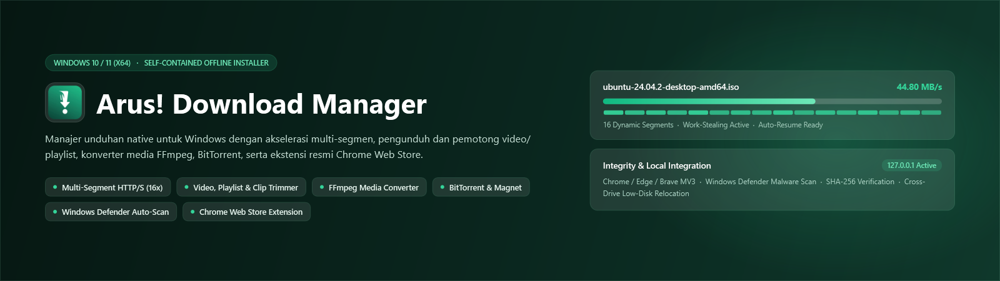

  

  
  
  
  
  

  <strong>Arus! Download Manager</strong> adalah aplikasi manajer unduhan native untuk Windows (64-bit) yang menggabungkan akselerasi HTTP/HTTPS multi-segmen, pengunduh dan pemotong video/playlist, konverter media offline, klien BitTorrent/Magnet, serta integrasi ekstensi browser resmi dalam satu paket instalasi mandiri.

  
  &nbsp;
  

---

## Tampilan Antarmuka

Antarmuka mendukung tema terang (*Light Mode*) dan gelap (*Dark Mode*) serta pilihan Bahasa Indonesia dan Inggris yang tersinkronisasi secara otomatis dengan ekstensi browser.

### Mode Terang

  

### Mode Gelap

  

---

## Kemampuan Utama

### 1. Mesin Unduhan & Reliabilitas Jaringan

| Kemampuan | Penjelasan |
|---|---|
| **Akselerasi Multi-Segmen Dinamis** | Memecah unduhan HTTP/HTTPS hingga 16 koneksi paralel dengan algoritma *dynamic work-stealing* (segmen yang selesai lebih awal otomatis membantu membelah sisa segmen terberat) serta grafik laju transfer *real-time*. |
| **Pemulihan Koneksi & Anti-Sleep** | Mendeteksi koneksi macet (*stall recovery*), melanjutkan unduhan otomatis saat jaringan kembali tersambung dari gangguan Wi-Fi/ISP, dan mencegah Windows masuk ke mode *Sleep* selama ada unduhan aktif. |
| **Pembaruan Tautan Kedaluwarsa** | Melanjutkan unduhan berukuran besar yang terhenti akibat tautan sementara kedaluwarsa (`HTTP 403` / `410`) cukup dengan memperbarui alamat unduhan tanpa mengulang progres dari awal. |
| **Mode Hemat Bandwidth & Kuota Harian** | Sakelar satu klik pada bilah status dan *System Tray* untuk membatasi pemakaian bandwidth saat rapat daring atau bermain gim, dilengkapi pembatas **Kuota Data Harian (GB/hari)** otomatis. |
| **BitTorrent, Magnet, & Proxy** | Mendukung berkas `.torrent` dan tautan `magnet:?` dengan pengaturan batas kecepatan unggah serta durasi *seeding*, ditambah dukungan Proxy Sistem, `HTTP`, dan `SOCKS5` dengan enkripsi kredensial Windows DPAPI. |

### 2. Pengunduh Video, Audio, & Konversi Media

| Kemampuan | Penjelasan |
|---|---|
| **Video & Playlist Multi-Platform** | Mengunduh video tunggal maupun seluruh *playlist* dari YouTube (pemilihan resolusi instan hingga 4K dan subtitel `.srt`), TikTok, Instagram, Threads, Facebook, serta X/Twitter. |
| **Pemotong Klip & YouTube Chapter** | Mengunduh rentang durasi tertentu (`mm:ss` hingga `mm:ss`) atau memilih bab (*chapter*) video YouTube secara langsung sehingga tidak perlu mengunduh keseluruhan berkas video. |
| **Ekstraksi MP3 320kbps & Thumbnail** | Mengekstrak audio langsung ke format `.mp3` 320kbps lengkap dengan sampul album (*cover art*) dan metadata ID3, serta opsi penyimpanan gambar *thumbnail* resolusi asli. |
| **Konverter Media Offline Bawaan** | Mengonversi berkas video atau audio yang sudah terunduh menjadi **MP3 320kbps**, **GIF animasi**, atau **MP4 ringkas (H.264)** langsung dari menu klik kanan tanpa koneksi internet. |

### 3. Manajemen Berkas, Antrean, & Otomasi

| Kemampuan | Penjelasan |
|---|---|
| **Relokasi Saat Penyimpanan Penuh** | Memeriksa sisa ruang penyimpanan sebelum dan selama proses unduh. Ketika partisi tujuan penuh, berkas sementara (`.aruspart`) dapat dipindahkan ke drive lain untuk dilanjutkan tanpa kehilangan progres. |
| **Ekstraksi Arsip Universal** | Mengekstrak arsip `.zip`, `.rar`, `.7z`, `.tar.gz`, `.tar.xz`, dan `.tgz` secara otomatis saat selesai maupun secara manual ke subfolder terpisah melalui menu klik kanan. |
| **Aturan Folder Pintar & Ganti Nama (`F2`)** | Mengarahkan lokasi penyimpanan otomatis berdasarkan kata kunci domain atau ekstensi berkas (*Smart Folder Rules*), serta mengganti nama berkas di daftar sekaligus di disk menggunakan pintasan `F2`. |
| **Manajemen Antrean & Penjadwal** | Mendukung *Force Start*, pengaturan urutan prioritas antrean, penjadwalan jam mulai/berhenti harian, pengunduhan beruntun pola angka (`[01-20]`), serta opsi *Sleep* atau *Shutdown* otomatis dengan hitung mundur pembatalan 30 detik. |
| **Pemantauan Clipboard, Pemulihan, & Cadangan** | Pemantau tautan *clipboard* opsional, widget *drag-and-drop* melayang, deteksi berkas lokal yang terhapus disertai opsi unduh ulang satu klik, serta ekspor/impor cadangan pengaturan dan riwayat (`.json`). |

### 4. Integrasi Browser, Keamanan, & Pembaruan

| Kemampuan | Penjelasan |
|---|---|
| **Ekstensi Resmi Chrome Web Store** | Ekstensi Manifest V3 resmi untuk Google Chrome, Microsoft Edge, dan Brave dengan intersepsi unduhan otomatis, tombol cepat di pemutar video, dan menu konteks klik kanan pada tautan maupun gambar. |
| **Pemindaian Windows Defender** | Memindai berkas yang selesai diunduh secara otomatis menggunakan mesin **Windows Defender** lokal (termasuk pemeriksaan isi arsip) dan menerapkan penanda keamanan standar Windows (*Mark-of-the-Web*). |
| **Verifikasi Hash & Pembaruan Aman** | Dilengkapi fitur pencocokan *checksum* `SHA-256` dan `MD5` langsung pada panel inspeksi berkas, serta *Auto-Updater* aplikasi bawaan yang mewajibkan verifikasi integritas `SHA-256` sebelum instalasi. |

---

## Instalasi

1. Buka halaman **[Releases Terbaru](https://github.com/baharidameta0-prog/arus-download-manager/releases/latest)**.
2. Unduh berkas **`Arus-Setup-x.y.z.exe`** (*Full Offline Installer* untuk pemasangan awal maupun pembaruan manual).
   *Catatan: Berkas `Arus-Update-x.y.z.exe` hanya digunakan secara internal oleh fitur Auto-Updater di dalam aplikasi.*
3. Jalankan installer dan ikuti langkah pemasangan hingga selesai. Seluruh dependensi runtime dan mesin pengolah media sudah termasuk di dalam paket instalasi.
4. Buka Google Chrome, Microsoft Edge, atau Brave, lalu aktifkan ekstensi **Arus! Download Manager** ketika notifikasi pemasangan muncul, atau pasang langsung melalui **[Chrome Web Store](https://chromewebstore.google.com/detail/mdidagnhjbilkgbafhchnghoflbakfmk)**.

> **Informasi Windows SmartScreen:** Apabila muncul peringatan *"Windows protected your PC"* saat menjalankan installer, klik **More info** lalu pilih **Run anyway**. Hal ini wajar untuk perangkat lunak independen yang didistribusikan secara gratis tanpa sertifikat *Extended Validation (EV)* berbayar. Setiap rilis selalu menyertakan berkas **`checksums.txt`** (`SHA-256`) untuk verifikasi keaslian paket instalasi.

---

## Arsitektur & Privasi

- **Komunikasi Lokal Terisolasi:** Integrasi antara ekstensi browser dan aplikasi desktop hanya berjalan melalui soket *loopback* lokal (`127.0.0.1`) yang memvalidasi identitas ekstensi resmi dan menolak permintaan lintas situs (*cross-origin*).
- **Tanpa Pengumpulan Data:** Aplikasi bekerja sepenuhnya di perangkat lokal pengguna tanpa telemetri, pelacakan riwayat unduhan, iklan, maupun pengiriman data ke server perantara.
- **Penyimpanan Kredensial Terlindungi:** Kredensial sensitif seperti kata sandi proxy dienkripsi di penyimpanan lokal menggunakan mekanisme *Windows Data Protection API (DPAPI)* khusus akun pengguna aktif.
