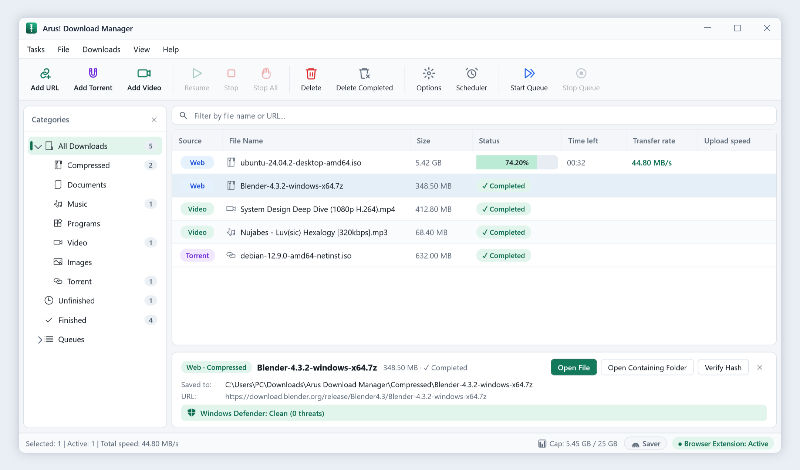
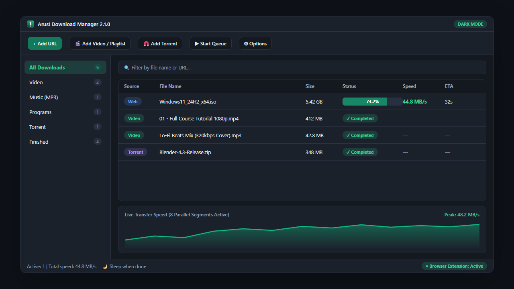

  

  
  
  
  

<h3 align="center">Unduh apa aja, sekencang arus.</h3>

  Native Windows Download Manager yang cepat, modern, dan ringan — lengkap dengan akselerasi multi-segmen, Video &amp; Playlist Grabber, MP3 Cover Art, BitTorrent/Magnet, serta integrasi Ekstensi Chrome/Edge resmi ala IDM.

  

---

## ✨ Fitur Unggulan

| Fitur | Deskripsi |
|---|---|
| ⚡ **Multi-Segment Accelerator (hingga 16 koneksi)** | Memecah file besar secara paralel lengkap dengan visualisasi segmen & grafik kecepatan live real-time. |
| 🎬 **Video, Playlist & Social Media Grabber** | Mendukung **YouTube** (0 ms instant quality + **Full Playlist**), **TikTok**, **Instagram**, **Threads**, **Facebook**, & **X/Twitter**, lengkap dengan **Subtitle (.srt)**. |
| 🎵 **1-Klik MP3 320kbps + Cover Art** | Ekstrak audio kualitas terbaik langsung ke `.mp3` 320kbps lengkap dengan thumbnail tertanam & metadata ID3. |
| 🧲 **BitTorrent & Magnet Built-in** | Unduh file `.torrent` dan tautan `magnet:?` tanpa aplikasi tambahan. |
| 🧩 **Ekstensi Browser Resmi (Chrome Web Store)** | Terpasang otomatis oleh installer di **Chrome, Edge, & Brave** — auto-intercept unduhan, tombol cepat MP3/Playlist di video, dan klik kanan **Download image/link with Arus!**. |
| 📦 **Batch Download & Auto-Extract `.zip`** | Impor banyak link sekaligus (termasuk pola angka `[01-20]`) dan ekstrak arsip `.zip` secara otomatis begitu selesai. |
| 🛡️ **Verifikasi Checksum (SHA-256 / MD5)** | Hitung & cocokkan hash file langsung di dalam Arus! untuk memastikan file `.iso`/installer 100% asli dan utuh. |
| 📋 **Smart Clipboard Monitor & Floating Drop Widget** | Deteksi link otomatis saat `Ctrl+C`, plus widget melayang opsional untuk drag-and-drop link & file `.torrent`. |
| 🔄 **Refresh Download Address** | Link download kadaluarsa (HTTP 403) saat file besar sudah 80%? Tempel link baru dan lanjutkan tanpa ulang dari 0%! |
| 🌙 **Auto-Shutdown / Sleep & Penjadwal** | Atur antrean unduhan terjadwal dan matikan/sleep PC otomatis (dengan hitung mundur aman 30 detik) begitu semua selesai. |
| 🎨 **Light & Dark Mode + Bahasa ID / EN** | Tema aplikasi & ekstensi browser otomatis sinkron secara real-time. |
| 🚀 **Full Offline & Auto-Update** | Installer sudah membundel semua komponen (tidak perlu install .NET/engine terpisah) + auto-updater bawaan dengan verifikasi **SHA-256**. |

---

## 🖥️ Tampilan Aplikasi

### Light Mode (Klasik & Bersih)

  

### Dark Mode (Nyaman di Mata)

  

---

## 📥 Cara Install

1. Buka halaman **[Releases Terbaru](https://github.com/baharidameta0-prog/arus-download-manager/releases/latest)**.
2. Unduh **`Arus-Setup-x.y.z.exe`** *(Full Offline Installer — untuk pengguna baru)*.
   *(Catatan: `Arus-Update-x.y.z.exe` digunakan otomatis oleh fitur Auto-Updater di dalam aplikasi.)*
3. Jalankan installer → klik **Next → Install**.
4. Buka Chrome / Edge / Brave → klik **Enable extension** saat popup **Arus! Download Manager** muncul di pojok kanan atas.
5. Selesai! Arus! otomatis standby di System Tray setiap Windows dinyalakan.

> **Catatan Windows SmartScreen:** Karena Arus! adalah aplikasi indie gratis tanpa sertifikat berbayar, jika muncul layar biru *"Windows protected your PC"*, cukup klik **More info → Run anyway**. Semua rilis dilengkapi **`checksums.txt` (SHA-256)** untuk verifikasi keaslian file.

---

## 🔒 Privasi 100% Lokal

- Seluruh proses unduhan dan komunikasi antara ekstensi browser dan aplikasi desktop berlangsung **100% lokal di perangkat kamu (`127.0.0.1`)**.
- Tidak ada telemetri, pelacakan aktivitas, iklan, atau pengiriman data pengguna ke server eksternal.

---

  Dibuat dengan ❤️ untuk pengalaman download Windows yang lebih cepat, rapi, dan tanpa ribet.

